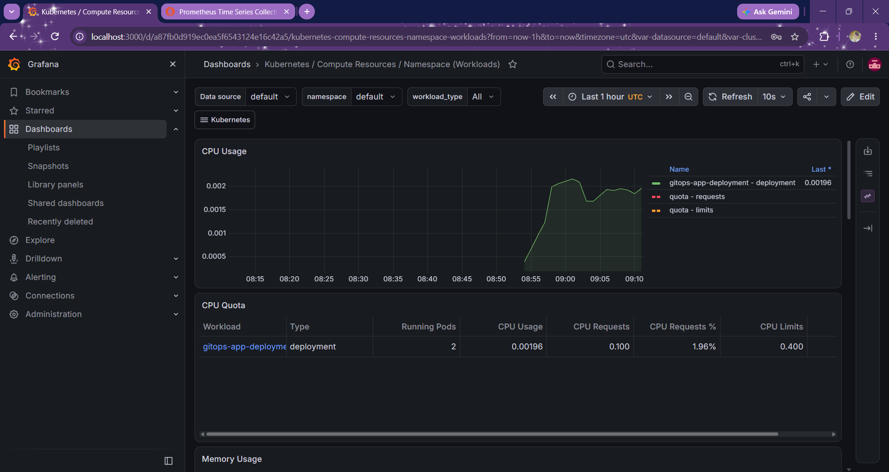
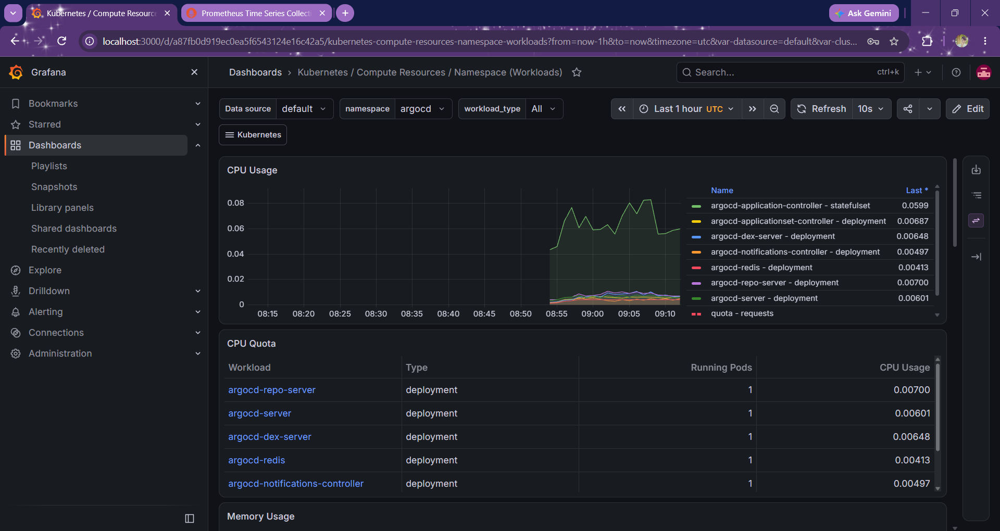
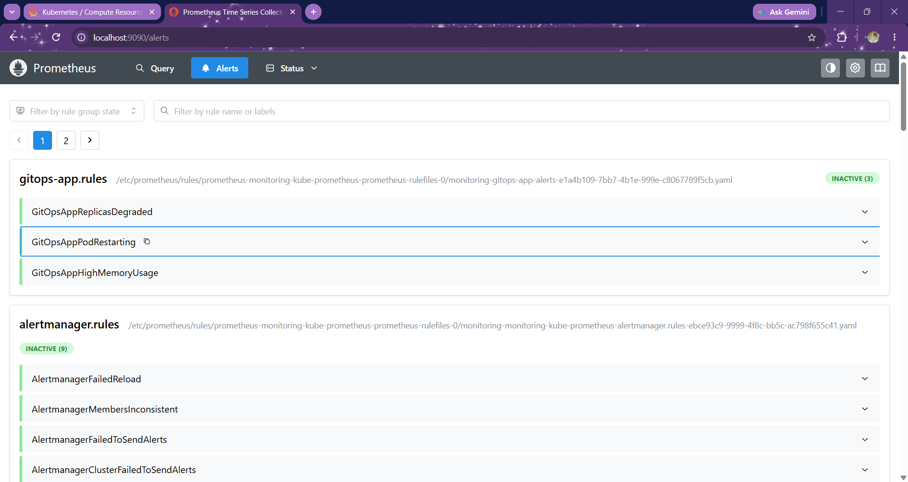

# Kubernetes Observability Stack: Prometheus, Grafana & Alertmanager

Production-style Kubernetes observability stack deployed via Helm (`kube-prometheus-stack`) to monitor microservices, GitOps controllers, and cluster health with custom PromQL alerting rules.

---

## Architecture Overview

```text
+-------------------------------------------------------------------+

|                   Kubernetes Cluster (Minikube)                   |
|                                                                   |
|  +---------------------------+   +-----------------------------+  |
|  |   default Namespace       |   |   argocd Namespace          |  |
|  |   gitops-app-deployment   |   |   Argo CD GitOps Engine     |  |
|  +-------------+-------------+   +--------------+--------------+  |
|                |                                |                 |
|                +---------------+----------------+                 |
|                                | cAdvisor / kube-state-metrics    |
|                                v                                  |
|  +-------------------------------------------------------------+  |
|  |                  monitoring Namespace                       |  |
|  |                                                             |  |
|  |  +----------------+   PromQL    +------------------------+  |  |
|  |  |   Prometheus   | <---------- |        Grafana         |  |  |
|  |  |  (TSDB + CRD)  |             |  (Workload Dashboards) |  |  |
|  |  +-------+--------+             +------------------------+  |  |
|  |          |                                                  |  |
|  |          | Evaluates PrometheusRule (gitops-app.rules)      |  |
|  |          v                                                  |  |
|  |  +----------------+                                         |  |
|  |  |  Alertmanager  |                                         |  |
|  |  +----------------+                                         |  |
|  +-------------------------------------------------------------+  |
+-------------------------------------------------------------------+
```

## Key Features

* **Helm-Managed Observability Stack:** Deploys Prometheus Operator, Prometheus, Grafana, Alertmanager, `kube-state-metrics`, and `node-exporter` using a resource-tuned `helm-values/values.yaml`.
* **Cross-Namespace Discovery:** Configured `serviceMonitorSelectorNilUsesHelmValues: false` and `ruleSelectorNilUsesHelmValues: false` so Prometheus dynamically discovers CRDs across all cluster namespaces.
* **Custom SRE Alerting (`PrometheusRule`):** Defined custom PromQL alerts in `manifests/gitops-app-alerts.yaml` monitoring replica availability (`GitOpsAppReplicasDegraded`), container restarts (`GitOpsAppPodRestarting`), and memory saturation (`GitOpsAppHighMemoryUsage`).
* **End-to-End Portfolio Integration:** Actively monitors both the hardened Go microservice (`default` namespace) and Argo CD GitOps engine (`argocd` namespace) from Project 1.

---

## Live Deployment Proof

### 1. Grafana — Microservice Workload Metrics (`default` Namespace)


### 2. Grafana — GitOps Controller Metrics (`argocd` Namespace)


### 3. Prometheus — Custom `PrometheusRule` Alerts (`gitops-app.rules`)


---

## Repository Structure

```text
k8s-prometheus-grafana-observability/
├── helm-values/
│   └── values.yaml                 # Resource-tuned kube-prometheus-stack Helm values
├── manifests/
│   └── gitops-app-alerts.yaml      # Custom PrometheusRule alerts for gitops-app
├── screenshots/
│   ├── grafana-gitops-app-dashboard.png
│   ├── grafana-argocd-namespace.png
│   └── prometheus-custom-alerts.png
└── README.md
```

---

## Quick Start

```bash
# 1. Add Prometheus Community Helm repo
helm repo add prometheus-community https://prometheus-community.github.io/helm-charts
helm repo update

# 2. Install kube-prometheus-stack with custom values
helm install monitoring prometheus-community/kube-prometheus-stack \
  --namespace monitoring \
  --create-namespace \
  -f helm-values/values.yaml

# 3. Apply custom PrometheusRule alerts for gitops-app
kubectl apply -f manifests/gitops-app-alerts.yaml

# 4. Access Grafana (admin / admin) and Prometheus locally
kubectl port-forward -n monitoring svc/monitoring-grafana 3000:80 &
kubectl port-forward -n monitoring svc/monitoring-kube-prometheus-prometheus 9090:9090 &
```

---

## Related DevOps Portfolio Projects

1. **[End-to-End Secure GitOps CI/CD Pipeline (`gitops-app`)](https://github.com/Veeresh-Shetter/gitops-app)** — Hardened non-root Go microservice, Trivy CVE scan gate, GHCR, and Argo CD automated sync.
2. **[Production AWS EKS Infrastructure with Terraform & FinOps (`aws-eks-terraform-iac`)](https://github.com/Veeresh-Shetter/aws-eks-terraform-iac)** — Modular Multi-AZ VPC, private Amazon EKS v1.31 cluster, Checkov IaC security CI, and Lambda cost-optimization auto-scaler.
3. **[Kubernetes Observability Stack (`k8s-prometheus-grafana-observability`)](https://github.com/Veeresh-Shetter/k8s-prometheus-grafana-observability)** *(This Repository)* — Helm-based Prometheus, Grafana, and Alertmanager monitoring with custom PromQL alerts.
